# E-Commerce Shopping Cart & Checkout System

Final Project Report

Team: Kusmangaliev Asanali, Sadykov Nurali, Argumbaev Damir

Group: SE-2509


This report describes the verified technical implementation. Personal contribution,
repository publication, Moodle submission and live defense are confirmed separately
by the team. Team-specific cover details can be updated in report_metadata.json.

# 1. Introduction

The project implements a coherent e-commerce shopping cart using six GoF design
patterns: Builder, Factory Method, Decorator, Adapter, Observer and Strategy.
Three students are responsible for at least two patterns each. The objective is
to demonstrate correct object creation, optional services, change notifications,
interchangeable discounts and payment integration through a single runnable scenario.

The chosen E-Commerce Shopping Cart topic retains its requested Builder, Observer
and Strategy. Factory Method, Decorator and Adapter complement product creation,
optional services and provider integration. There are two patterns in each category.
Simultaneous threads are not required: the patterns cooperate in a sequential workflow.

The implementation targets Java 17, uses Maven Wrapper and JUnit Jupiter, and has
no application runtime dependencies. The interface is a console application.
StripeSDK and KaspiPayAPI are explicitly educational simulations without network calls.

# 2. Body

## 2.1 Requirements and architecture

Exactly six top-level source packages exist. Main is the only production class
outside these packages. Each package contains subpackages corresponding to its
pattern roles. Shared monetary/product contracts remain inside builder/product;
cart models and inventory interfaces remain inside strategy. Tests also use these six packages.

```text
src/main/java/
  Main.java
  builder/{builders,director,product}/
  factory/{creators,products}/
  decorator/{base,concrete}/
  adapter/{adaptees,adapters,target}/
  observer/{events,observers,subject}/
  strategy/{context,model,strategies}/
```

Main is the composition root and executable demonstration. Business rules are
implemented in domain classes and can be tested independently of console output.

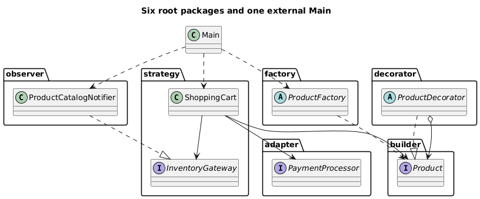

## 2.2 Builder — creational

ProductBuilder defines construction steps. CustomPCBuilder stores configuration,
CustomPC is the immutable result, and PCDirector contains gaming/workstation recipes.
The builder configures SKU, name, CPU, GPU, RAM, SSD and merchant-supplied base price.
Invalid component values are rejected on construction. Changing a builder after
build does not modify an existing PC. A director is optional for custom configurations.

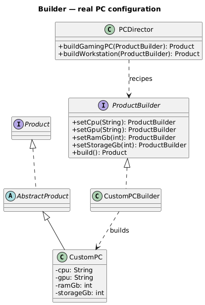

## 2.3 Factory Method — creational

ProductFactory declares createProduct. LaptopFactory and HeadphonesFactory override
the method to create StandardLaptop and WirelessHeadphones. Client code invokes
the creator abstraction polymorphically. Product choice is delegated to subclasses,
with no provider-type switch in ShoppingCart. Both concrete products implement Product
through AbstractProduct, which centralizes identity and price validation.

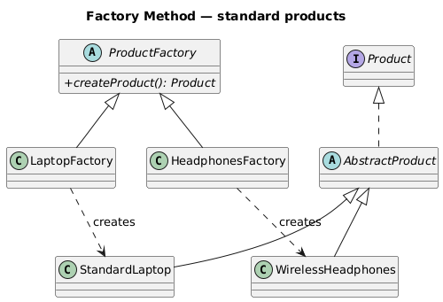

## 2.4 Decorator — structural

Product is a read-only component contract. ProductDecorator wraps another Product.
GiftWrapDecorator, ExtendedWarrantyDecorator and ExpressDeliveryDecorator add
descriptions and per-unit fees of 1500.00, 9000.00 and 3000.00 KZT respectively.
Wrapping allows service combinations without subclasses for every combination.
Decorators preserve SKU, enabling shared stock validation across differently decorated lines.

A decorated catalog product reads the live base price plus service fees. The design
deliberately separates catalog base-price mutation from the read-only Product interface,
preventing the uploaded version's inconsistent price setter and price-change notifications.

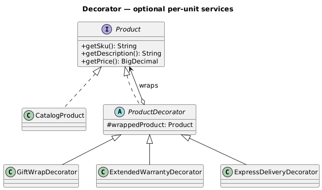

## 2.5 Adapter — structural

ShoppingCart expects PaymentProcessor.pay(BigDecimal). KaspiPaymentAdapter translates
this call to KaspiPayAPI.makePayment, while StripePaymentAdapter calls StripeSDK.chargeCard
with KZT currency. Cart logic depends on the target abstraction, not a specific provider.
A positive charge returns a nonblank confirmation or throws. Providers are simulated.

A zero-total order bypasses provider charging and still completes stock commitment
and cart clearing. This resolves the original contradiction between a valid 100 percent
discount and providers that accept only positive charges.

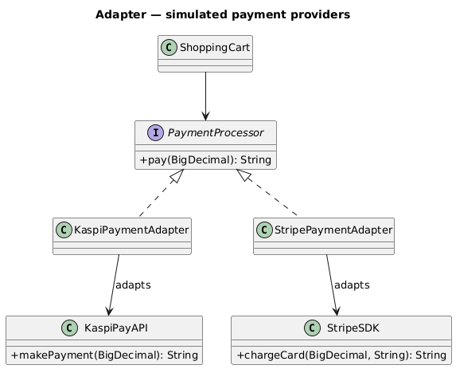

## 2.6 Observer — behavioral

ProductCatalogNotifier implements ProductSubject and publishes ProductEvent to
ProductObserver subscribers. CustomerAlertObserver displays base-price or stock changes.
CartSyncObserver references an existing cart and reads its actual current subtotal and
discounted total, including decorators. The catalog emits events for both price increases
and decreases, restocking and committed sales. An unchanged normalized price emits no event.

Event prices consistently refer to base catalog prices. For a laptop priced at 390000.00,
three services produce an actual decorated price of 403500.00. Notifications no longer
compare the old decorated price with the new base price. Observer subscriptions use a Set
to prevent duplicates. Runtime failures are recorded and do not block other observers.
Notifications are synchronous and immediate; no polling or background thread is needed.

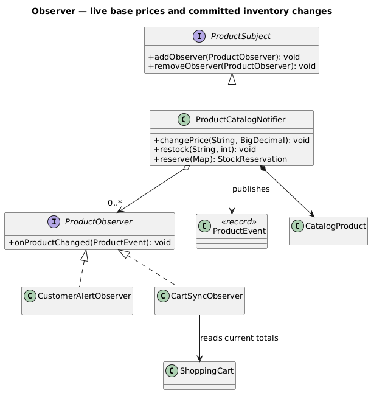

## 2.7 Strategy — behavioral

ShoppingCart is the context and accepts DiscountStrategy. NoDiscountStrategy returns
the subtotal, PercentageDiscountStrategy applies 0–100 percent, and PromoCodeDiscountStrategy
validates SAVE10 or STUDENT15 then delegates to the percentage implementation. Algorithms
can be replaced at runtime. The context rejects results outside the range 0 to subtotal.

All services are included in the subtotal before discount. Money uses BigDecimal,
two decimal places and HALF_UP. The percentage discount amount is rounded before subtraction.
Promo-code normalization uses Locale.ROOT. Financial values do not use double.

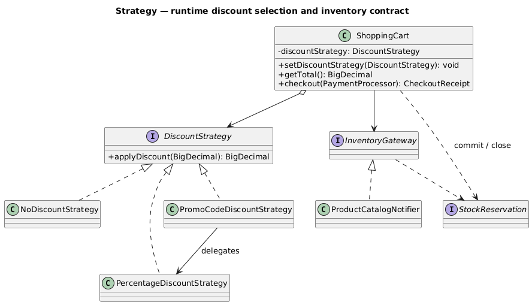

## 2.8 Unified checkout and inventory reservation

Built and factory-created configurations enter a catalog with live prices and stock.
Their catalog views are decorated and added to a cart. The cart uses a discount
strategy, reserves stock through InventoryGateway, pays through an Adapter, commits
the reservation and returns an immutable CheckoutReceipt. Inventory commitment triggers
Observer events. This demonstrates all six patterns within one application.

Quantities are aggregated by SKU, so different decorations cannot oversell the same stock.
Every SKU is validated before any stock is reserved. An uncommitted StockReservation.close
restores stock; try-with-resources ensures rollback on payment failure or invalid receipt.
Only committed sale events are published. The catalog permits one active reservation and
blocks overlapping/reentrant mutations until the reservation completes. The model is
deliberately single-threaded; these rules do not provide production concurrent transactions.

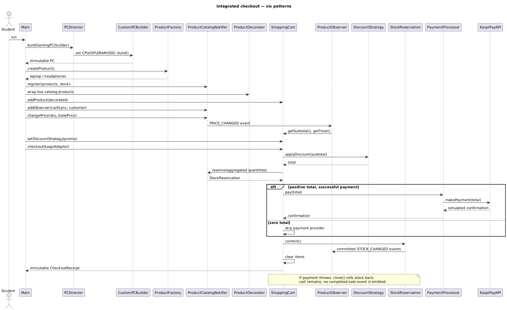

## 2.9 Reproducible calculation

Initial base prices are PC 850000.00, laptop 420000.00 and headphones 65000.00 KZT.
Adding 13500.00 services per product gives 1375500.00. After changing the laptop base
price to 390000.00, subtotal becomes 1345500.00. Five percent gives 1278225.00.
STUDENT15 gives a 201825.00 discount and final total 1143675.00 KZT.

The first checkout consumes one unit of each product, clears the cart and stores
an immutable price snapshot. Additional Main scenarios show Stripe, insufficient stock,
failed payment rollback and a 100-percent-discount order with no bank charge.

## 2.10 Clean Code, SOLID, KISS and DRY

| Principle | Implementation evidence |
|---|---|
| SRP | Construction, creation, services, notifications, discount algorithms and payment translation are separated |
| OCP | New strategies, decorators, observers, factories or payment adapters extend existing contracts |
| LSP | Product has consistent read-only semantics; decorated and base products substitute without ambiguous setters |
| ISP | InventoryGateway exposes reserve; StockReservation exposes commit/close; interfaces remain focused |
| DIP | ShoppingCart receives InventoryGateway, DiscountStrategy and PaymentProcessor abstractions |
| KISS | Plain Java, synchronous events, no unnecessary framework or concurrency |
| DRY | Shared Money validation, AbstractProduct identity rules, promo strategy reuses percentage logic |

Product definitions and receipt snapshots are immutable. Collections are exposed as
immutable copies. Map provides average O(1) SKU lookup; aggregation and processing of n
cart lines takes average O(n). Event delivery to s observers takes O(s). Explicit names,
validation and domain-level exceptions make the behavior inspectable during defense.

## 2.11 Verification

The project was compiled with Java release 17 and packaged as a runnable JAR.
Maven verify executes 33 test cases across six test classes with no failures or errors.
Tests cover all six patterns, exact decimal money, price/event consistency, real cart
synchronization, stock changes, duplicate SKUs, rollback, failed observers, zero-total
orders, immutable receipts, invalid inputs and integer overflow. Full output and
per-class summaries are included in docs/build-output.txt and docs/test-summary.txt.

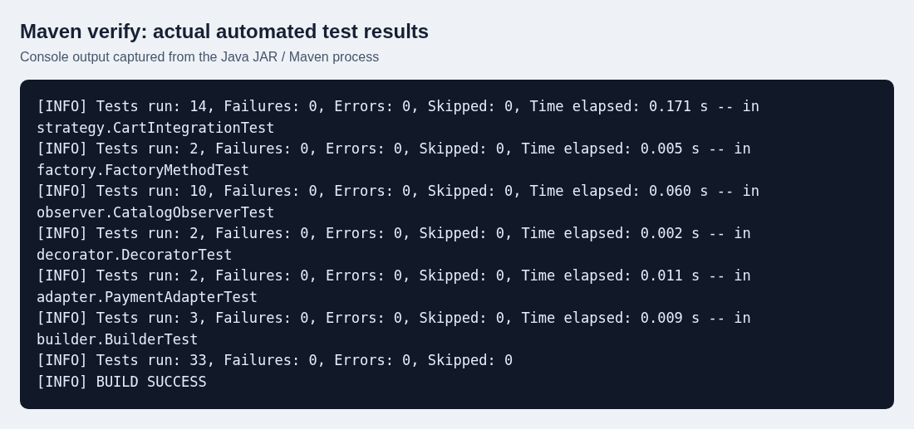

## 2.12 Screenshots of the application

The following screenshots show actual console output captured from the built Java JAR
and displayed in a browser console-output viewer. Raw output is included in demo-output.txt.
They document the implemented console interface. The team can additionally capture its
own IntelliJ run after importing the project.

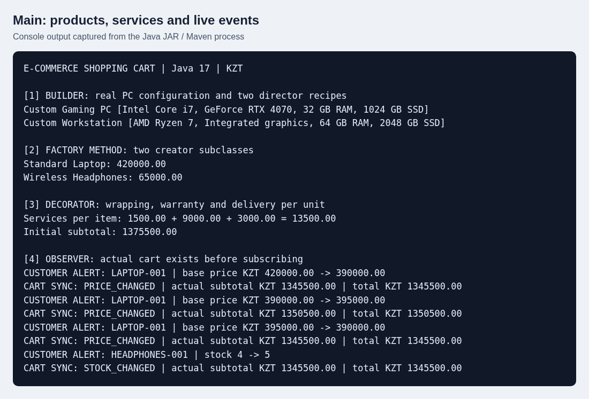

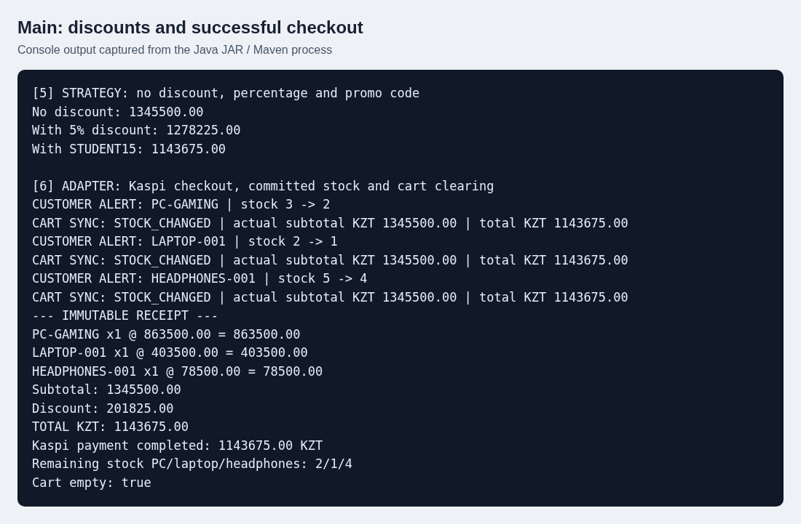

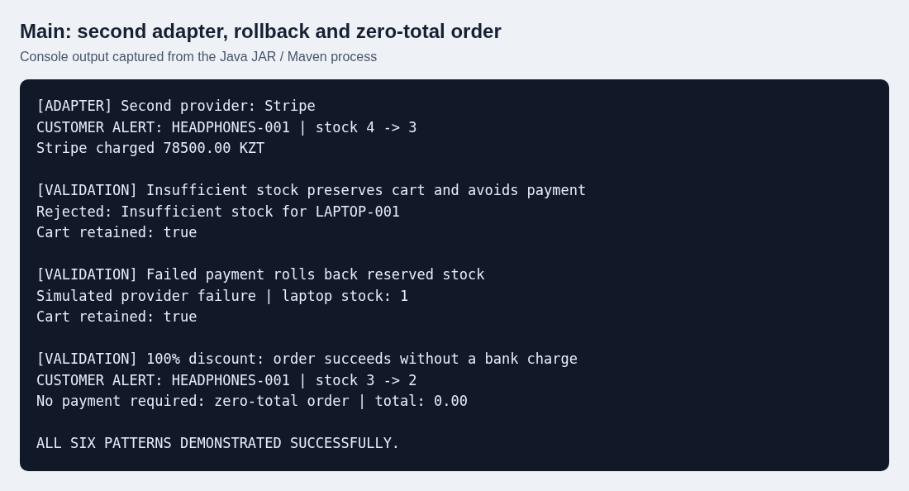

## 2.13 Team contributions, Git and submission

Suggested ownership: student 1 implements Builder and Factory Method; student 2
implements Decorator and Adapter; student 3 implements Observer and Strategy.
These roles are a plan, not evidence of completed personal contribution. Each student
must understand, implement/refine and test their two patterns and make genuine commits.

The actual repository link and all three contributors must be verified separately.
The .git directory need not be inside the submitted ZIP. A prepared archive cannot
substitute for contribution history. Each student submits PDF, source ZIP and Git link
individually to Moodle before the actual deadline and defends the work personally.
The supplied requirements PDF does not specify a deadline date.

Assessment: 50 percent code and Git link, 10 percent report, 40 percent defense covering
OOP and patterns. The additional conditions impose a 5-percent deduction per violation.
REQUIREMENTS_CHECKLIST.md maps every criterion to evidence or a remaining team action.

# 3. Conclusion

The corrected prototype integrates six operational GoF patterns in a coherent cart
and checkout workflow. It preserves the requested package hierarchy and demonstrates
price/stock notifications, real product configuration, interchangeable discounts,
composable services and payment adapters. Regression and integration tests confirm
the corrections to the uploaded version, including consistent price semantics and rollback.

The technical implementation and supporting report are prepared. Actual personal
contributions, Git publication, timely individual Moodle submission and the live defense
remain responsibilities of the team and are not represented as completed by this archive.

# 4. Further Work

- Add a database-backed catalog, order history and transactional inventory reservations.
- Support concurrent checkout with isolation, reservation expiration and recovery.
- Integrate official payment SDKs with idempotency and authorization/capture workflows.
- Add authentication, a GUI/web interface, taxes and configurable delivery policies.
- Add a component price catalog for automatically pricing custom PC configurations.
- Add structured logging, asynchronous notifications and retry policies.
- Add multicurrency support and explicit currency conversion rules.

# 5. References

- Final Project Defense Requirements.pdf and the user's additional assessment requirements.
- Gamma E., Helm R., Johnson R., Vlissides J. Design Patterns: Elements of Reusable Object-Oriented Software.
- Martin R. C. Clean Code: A Handbook of Agile Software Craftsmanship.
- Java 17 API documentation: https://docs.oracle.com/en/java/javase/17/docs/api/.
- JUnit 5 User Guide: https://junit.org/junit5/docs/current/user-guide/.
- Refactoring.Guru design pattern catalogue: https://refactoring.guru/design-patterns.

# Appendix A. Complete production Java source

Every production Java file is included below. Test source, Maven configuration and
Maven Wrapper are included in the source archive. Main is the only external source class.

